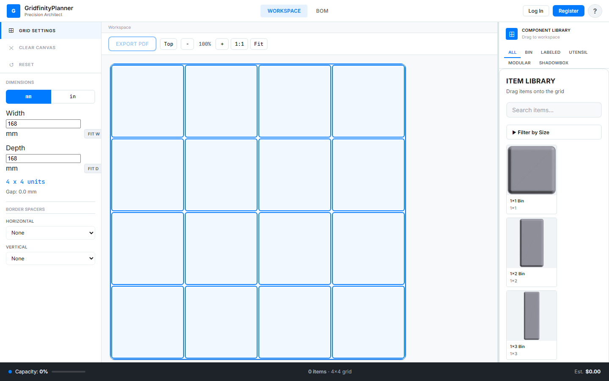

# Ordinus

A web-based visual layout tool for planning [Gridfinity](https://www.printables.com/model/274917-gridfinity-specification) modular storage systems. Drag bins onto a grid that matches your physical drawer, customize each bin, save layouts, and export a bill of materials.

---



---

## What is Gridfinity?

Gridfinity is an open-source modular storage system for 3D printing. Every bin snaps into a baseplate on a 42 mm grid — so anything you design here corresponds directly to physical hardware you can print. This tool lets you plan the layout before printing a single part.

---

## Features

### Grid & Layout
- **Configurable grid** — set width and depth in mm or inches; the tool calculates how many 42 mm units fit and shows gap sizes
- **Drag-and-drop** — drag bins from the Component Library onto the grid
- **Move, rotate, delete** — reposition with mouse or touchscreen; rotate CW/CCW; delete individually or multi-select for bulk operations
- **Collision detection** — green outline = valid placement; red outline = overlap
- **Zoom & pan** — scroll-wheel zoom, middle-click/Space+drag pan, Fit-to-screen button; floating zoom overlay stays anchored to the canvas on all screen sizes
- **Ortho / 3D view** — toggle between a flat top-down view and perspective renders of each bin

### Component Library
- **Pre-built bins** — standard bins, labeled bins, utensil trays, modular inserts, shadowbox trays; multiple size variants for each
- **Category tabs** — All, Bin, Labeled, Utensil, Modular, Shadowbox
- **Size filter** — collapse the library to specific footprints
- **Search** — filter by name
- **Favorites** — heart any placed item to save it to your Favorites tab; drag directly from Favorites to re-place customized configurations
- **Per-item customization** — wall cutout sides (front/back/left/right), height (in Gridfinity units), and other bin-specific parameters

### Reference Images
- **Upload photos or diagrams** — overlay an image of your actual drawer or tools directly on the grid
- **Position, scale, rotate** — drag to move; handles to resize; CW/CCW rotation buttons
- **Opacity** — adjust transparency to see the grid through the image
- **Lock** — freeze a reference image to prevent accidental movement
- **Multiple images** — layer as many references as needed

### Save & Load
- **Save as New** — name a layout and save it
- **Direct Save** — one-tap update when a layout is already saved; amber "unsaved changes" indicator appears in the breadcrumb whenever edits are pending
- **Saved Configs** — browse all your saved layouts, load or clone any of them
- **Clone** — duplicate a layout to iterate on it without losing the original

### Export & BOM
- **Bill of Materials** — live count of each bin type with quantities
- **PDF export** — export a print-ready order summary with the BOM and grid dimensions

### Mobile
- **Bottom action bar** — on screens ≤ 1024 px wide, a native-style tab bar replaces the desktop toolbar: Load, Save, Export, Ortho/3D toggle, Clear
- **Long-press Save** — hold the Save button for 500 ms to open Save as New instead of overwriting
- **Touch pan & pinch-zoom** — full touch support on the canvas

---

## Usage Workflow

### Simple layouts

Choose **Simple** in the workspace for a focused drawer-planning workflow. Create a **New library**, add existing fixed bins or a **parametric bin**, then save the library. Parametric bins use the existing custom-bin generator; each width/depth axis can accept a range, a list of allowed sizes, or one fixed size.

Use **Add named option** to expose friendly choices such as Short, Medium, and Tall. Each choice can map multiple inputs, including height and generator settings. The initial height examples are editable. Height uses 7 mm units; footprint width/depth use 42 mm grid units. Collections reference existing models without copying their files and persist on the server.

Select the library, click **Draw bin**, and drag a rectangle in either direction. Alternatively, expand **Enter a rectangle with the keyboard** to enter its origin and dimensions in grid units. Choose a compatible bin and named options, then **Place bin**. Fixed bins match in either orientation. Incompatible bins and presets remain visible as **Unsupported**; select one to see why (size limits, preset restrictions, half-grid support, or an unavailable source). Unsupported selections cannot be placed. Escape or Cancel discards the rectangle. Existing placed bins are retained when switching between Simple and Advanced, and resolved parametric settings remain part of saved layouts even if the library later changes.

### 1. Set your grid size

The left panel shows **Width** and **Depth** inputs. Enter your drawer's interior dimensions in mm (or switch to inches). The grid summary updates live — "4 × 4 units · Gap: 0.0 mm" means the grid fits exactly four 42 mm units in each direction.

Use **FIT W** / **FIT D** to snap to the nearest whole number of units if your drawer isn't an exact multiple of 42 mm.

### 2. Configure border spacers (optional)

Under **Border Spacers**, add horizontal or vertical spacers around the grid edge to account for drawer walls or lips that reduce usable space.

### 3. Browse the library and drag bins onto the grid

The Component Library on the right lists all available bin types. Scroll or use the category tabs and search to find what you need. Drag a bin from the library onto any open cell — green outline means the placement is valid.

### 4. Customize each bin

Click a placed bin to select it, then use the inline toolbar that appears:
- **Rotate** (CW / CCW)
- **Customize** — opens a panel for per-bin options: height (Gridfinity units), wall cutout sides, and other parameters specific to that bin type
- **Favorite** — saves this bin + its current customization to your Favorites tab
- **Duplicate** or **Delete**

### 5. Use a reference image (optional)

If you want to design around existing tools or check clearances, upload a photo of your drawer or its contents:

1. Switch to the **Images** tab in the library panel
2. Drag your image onto the grid or click **Upload Reference Image**
3. Drag the image to align it with the grid
4. Use the scale handles to match real-world size
5. Adjust **Opacity** so you can see the grid through the image
6. Click **Lock** to freeze the image once positioned

### 6. Save your layout

The toolbar shows **Save** and **Load** buttons:

| Situation | Action |
|-----------|--------|
| New layout (never saved) | Click **Save** → enter a name |
| Existing layout with changes | Click **Save** to overwrite; amber dot + "unsaved changes" in the breadcrumb shows pending edits |
| Save a copy | Long-press **Save** (desktop: right-click or use the save-as-new dialog) |

### 7. Export

Click **Export PDF** to download a print-ready summary with:
- A snapshot of the grid
- Full bill of materials with quantities
- Drawer dimensions

### 8. Load a saved layout

**Saved Configs** (top nav) shows all your saved layouts as cards. Click **Edit** to open a layout in the workspace, or **Duplicate** to fork it.

---

## Keyboard Shortcuts

| Key | Action |
|-----|--------|
| `Delete` / `Backspace` | Delete selected item(s) or reference image |
| `R` | Rotate selected item(s) CW |
| `Shift+R` | Rotate selected item(s) CCW |
| `Ctrl+D` | Duplicate selected item |
| `Ctrl+C` / `Ctrl+V` | Copy / Paste |
| `Ctrl+A` | Select all items |
| `Esc` | Deselect all |
| `V` | Toggle Ortho / 3D view |
| `L` | Lock / unlock selected reference image |
| `R` (image selected) | Rotate reference image CW |
| `+` / `-` | Zoom in / out |
| `Ctrl+0` | Reset zoom to 100% |
| `Space + drag` | Pan the canvas |
| `?` | Open keyboard shortcut reference |

---

## Development Setup

### Owner login and recovery

Ordinus requires one owner login with username **admin**. There is no default
password and no public registration. Existing layouts, libraries, and customer
records remain intact; customer profiles are not login accounts.

Before first login, provision a password of 8 to 256 characters through one of
these private administration paths:

- Set `ADMIN_SETUP_PASSWORD_FILE` to a privately mounted file containing the
  password before starting the server. Startup reads it only when an admin does
  not exist. Remove the bootstrap file after provisioning. Restarts never replace
  an existing password with the bootstrap value.
- Pipe the password on standard input to `npm run admin:setup --workspace=server`
  in a local checkout, or `node server/dist/admin-setup.js` in the container.
  Use the same `DB_PATH` as the running deployment. Stop the server while using
  the standalone setup command. Do not pass the password as a command argument.
  The command refuses to replace an existing account.

Set `CORS_ORIGIN` and `PUBLIC_URL` to the exact browser origin. Prefer the normal
same-origin `/api/v1` proxy. Production cookies require HTTPS by default. For an
explicitly local HTTP installation, set `AUTH_COOKIE_SECURE=false`; use secure
cookies when publishing through HTTPS. Owner sessions expire after 12 hours.

For a forgotten password, select **Reset admin password**, request a code, and
find the `admin_password_reset_code` event in server/container logs. Match its
request reference to the page. Enter that code and the new password. Codes expire
after 10 minutes, allow at most five attempts, and are invalidated after one
successful use. Requesting another code does not cancel an earlier unexpired
code. Issuance is limited to three requests per 15 minutes for the single admin.
Successful reset invalidates all owner sessions, including open event streams,
and requires signing in again. It preserves saved data.

Access to deployment logs is the password-recovery authority. The dedicated reset
event intentionally includes the usable code and is emitted even at restrictive
configured log levels. Passwords, session cookies, and reset codes are never
included in HTTP responses. Keep logs private to deployment administrators.

All ordinary APIs, private assets, downloads, settings, and generation streams
require the owner session. Browser mutations validate the request Origin.
Non-browser clients must log in, retain the session cookie, and include
`X-Ordinus-Request: 1` on mutations. Health endpoints remain public.

### Authenticated end-to-end tests

`npm run test:e2e` runs a separate disposable stack on ports **5187** (UI) and
**3017** (API), using an in-memory database. It never reuses a running development
server. Playwright provisions an admin through `ADMIN_SETUP_PASSWORD_FILE`, signs
in through the actual UI, and reuses authenticated storage state for feature tests.

Set `ORDINUS_E2E_ADMIN_PASSWORD` to provide a private test credential, including
through the CI secret of the same name. When omitted for local tests or fork PRs,
the harness generates a fresh random password. Credentials/storage state live
under ignored `app/e2e/.auth/` and are removed on teardown; do not upload that
directory as an artifact. Anonymous tests use clean browser contexts. Reset tests
launch a separate temporary, file-backed API on **3018** to test revocation and
restart persistence without signing out other tests. Auth/reset tests disable
trace, video, and screenshot artifacts containing recovery input.

For Docker E2E, use a dedicated disposable test deployment, provision its admin
privately first, and supply the matching `ORDINUS_E2E_ADMIN_PASSWORD`.
External integration harnesses must provision a test admin and log in with a
cookie before configuring settings or submitting layouts. Anonymous integration
calls are no longer supported. Concordia maintains its own integration; its
future adaptation is tracked separately in
[BIZ-374](https://linear.app/deviant-mushroom/issue/BIZ-374/concordia-update-ordinus-integration-tests-for-admin-authentication).

**Prerequisites:** Node.js 20+, npm 10+

```bash
git clone https://github.com/mgomezdev/GridfinityCustomizer.git
cd GridfinityCustomizer
npm install
npm run build --workspace=shared   # required before first server start
```

Start the backend and frontend in separate terminals:

```bash
# Terminal 1 — backend API (port 3001)
npm run server:dev

# Terminal 2 — frontend dev server (port 5173)
npm run dev
```

Open `http://localhost:5173`.

### Sharing and live collaboration

From the workspace, choose **Share preview**. Ordinus saves the current drawer
before opening the sharing panel and again before creating a link, including
changes made while the panel is open. A new workspace asks for a configuration
name first. If saving fails, no new link is issued. Sharing is available on
desktop and mobile without leaving the workspace.

You can also open **Saved Configs** and choose **Share preview** on a saved
configuration. Select an expiry (1 hour, 24 hours, or 7 days), create the link,
and copy it before leaving the sharing panel. Open it in a private browser window
to test the client experience without an admin session.

The guest sees only that saved drawer, its bin models, and its attached reference
photos. **Top** and **3D** switch between the same rendered model views used in
the workspace, including saved rotation and custom-bin settings. Sharing prepares
any missing generated previews; the guest view checks readiness and displays them
when available. Missing or failed images retain the footprint and a clear status.
Guests receive previews only for bins placed in this drawer. Global generation
controls, model/STL downloads, customer records and other configurations remain
private.

Links default to a **read-only preview**. To work together, enable **Allow client
editing (live)**, choose the **Approved bin library**, then select **Create
collaboration link**. Send the client that link and choose **Open live editor**
for your own editing view. Existing preview links keep their original read-only
permissions.

The organizer and client can both drag or move bins, place approved models,
rotate/remove bins, change supported height/lip/pattern options, and adjust drawer
dimensions and spacers. Accepted edits save automatically and appear for everyone
without reloading. **Top** and **3D** viewing, selection and local form drafts
remain personal to each browser. Clients can see attached reference photos;
uploads, photo editing and other admin actions stay with the organizer.

Simultaneous changes are checked against a layout revision. If someone changes
the drawer while a form is open, review the updated grid and select **Use latest
revision for these values** before retrying. As in the regular workspace,
overlapping and out-of-bounds bins remain editable and are flagged for everyone
to resolve; shrinking the drawer preserves its bins and flags those that no
longer fit. Lost connections pause
editing and reconnect automatically. If a change's acknowledgement is lost,
**Retry last change** checks the same command so it cannot apply twice. Returning
to Workspace or BOM loads the latest shared drawer first.

Both participants use the workspace's drag-and-drop, snapping previews,
overlap detection, zoom/pan and pinch controls. Drag approved library footprints
into the drawer; on a phone open **Bin library** first. Shift/Ctrl-click selects
multiple bins for atomic group moves, rotation and deletion. Right-click opens
the workspace bin menu. **R** / **Shift+R** rotate, **Delete** removes,
**Ctrl/Cmd+D** duplicates, and **Ctrl/Cmd+C/V** copies/pastes within this drawer.
The library and attached images remain scoped to the invitation.

Choose **Close access** in the configuration's sharing panel to revoke an
invitation and every guest session created from it. Open previews check access
every two seconds and hide the drawer if access closes or cannot be verified.
Live sessions receive closure immediately and stop accepting edits. **Close live
guest access** in the organizer's editor closes every editable invitation for
that drawer. View-only invitations are managed individually in the sharing panel.
Leaving clears that browser's guest session; invitations remain valid until their
expiry or closure. Anyone holding an invitation has its configured access, and
participant names are display labels.

Live events and presence currently use one Node API process, matching the Docker
deployment. Revisions, command deduplication, invitation credentials and closure
are durable across restarts. Once a drawer has used collaboration, ordinary full
saves also require its last-read revision, even after access closes. Stale tabs
receive a conflict instead of overwriting shared work. The initial pre-live
snapshot is retained privately in SQLite for support/recovery. See
[the collaboration contract](docs/live-collaboration.md) for API details.

### Common commands

```bash
npm run dev              # Frontend dev server with HMR
npm run server:dev       # Backend dev server (tsx watch)
npm run test             # Unit tests in watch mode
npm run test:run         # Unit tests (single run)
npm run test:e2e         # Playwright E2E tests
npm run lint             # ESLint
npm run build            # Production build (all packages)
```

See [CLAUDE.md](CLAUDE.md) for full coding standards, architecture notes, and git workflow, and [docs/agent/](docs/agent/README.md) for deeper backend/frontend/data-model/integration notes.

---

## Docker Deployment

The production stack runs as two containers behind Nginx. The host port is `ORDINUS_PORT` (default `3001`).

```bash
# Build and start
docker compose -f infra/docker-compose.yml up --build -d

# Rebuild from scratch (after dependency changes)
docker compose -f infra/docker-compose.yml down
docker compose -f infra/docker-compose.yml build --no-cache
docker compose -f infra/docker-compose.yml up -d
```

Visit `http://localhost:3001` (or whatever `ORDINUS_PORT` is set to).

---

## Project Structure

```
app/            React 19 + TypeScript frontend (Vite)
  src/
    components/   UI components
    contexts/     React context providers (WorkspaceContext, …)
    hooks/        Custom hooks (grid items, layout loader, zoom, …)
    pages/        Route-level pages (Workspace, SavedConfigs, OrderSummary)
    types/        Shared TypeScript types
    utils/        Pure utilities (conversions, PDF export, …)
  e2e/          Playwright E2E tests
server/         Express + SQLite backend (drizzle-orm, libsql)
shared/         Types and schemas shared between app and server
```

---

## About This Project

Ordinus is built as an exercise in full agent coding with human oversight — a real, useful tool developed while demonstrating practical applications of emerging techniques in prompt design, multi-agent workflows, and harnessing.

## License

Open source. License TBD.
